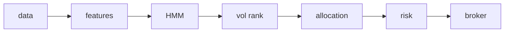

# regime-trader

**risk management > signal generation**

An educational, long-only volatility-regime allocation system for US equities.
A Gaussian HMM classifies market conditions; volatility rank selects the allocation
strategy. Independent risk checks have final authority over every entry. Regime
names describe training returns; they do not predict market direction.



Data adapters provide OHLCV history and completed bars. Features use trailing
indicators and rolling z-scores. The HMM uses causal forward filtering, stability
confirmation and flicker detection. Strategies map volatility ranks to allocation,
EMA/ATR stops and uncertainty scaling. Risk applies position, exposure, leverage,
sector, correlation, spread, duplicate and drawdown checks. The broker adapter
places protective orders and reconciles actual holdings and stops.

| Path | Purpose |
| --- | --- |
| `data/` | Historical/streaming data and causal feature engineering |
| `core/hmm_engine.py` | Gaussian HMM fitting, BIC selection and forward inference |
| `core/regime_strategies.py` | Volatility rank, allocation and stop generation |
| `core/risk_manager.py` | Entry vetoes, sizing and circuit breakers |
| `core/trading_loop.py` | Session lifecycle, monitoring and state recovery |
| `broker/` | Lazy Alpaca connection, execution and position tracking |
| `backtest/` | Walk-forward simulation, benchmarks, metrics and crash injection |
| `monitoring/` | Terminal dashboard, JSON audit logs and optional alerts |
| `config/settings.yaml` | Documented system parameters |
| `tests/` | Synthetic unit and integration tests |
| `main.py` | CLI entry point |

The CLI uses the strategy orchestrator directly; `core/signal_generator.py` is a
legacy, unimplemented facade and is not part of the working execution path.

## Quick start — six steps

These are operator instructions. Training, historical downloads and live sessions
require network access; the default test suite uses synthetic data and mocks.

1. Create and activate a Python environment: `python -m venv .venv`, then
   `source .venv/bin/activate`.
2. Install dependencies: `pip install -r requirements.txt`.
3. Copy `.env.example` to `.env` and supply your own Alpaca **paper** keys.
   Review `config/settings.yaml`; keep `broker.paper_trading: true`. Credentials
   are loaded from environment/`.env` only on explicit connection, never at import.
4. Run `python -m pytest tests/ -v`, then `python main.py train-only`.
5. Run `python main.py backtest --symbols SPY --start 2020-01-01 --end 2024-12-31 --compare`
   and review returns, drawdowns, trades, regime statistics and benchmarks honestly.
6. Start `python main.py live --dry-run`. After review, use `python main.py live`
   for paper orders and complete at least 30 days of paper review before going live.

## CLI reference — L12

```bash
# Setup
pip install -r requirements.txt
cp .env.example .env                    # Edit with your Alpaca keys

# Training
python main.py train-only              # Train HMM model

# Backtesting
python main.py backtest --symbols SPY --start 2020-01-01 --end 2024-12-31
python main.py backtest --compare      # Include benchmark comparisons
python main.py backtest --stress-test  # Run crash injection tests

# Live Trading
python main.py live --dry-run          # Full pipeline, no orders
python main.py live                    # Paper trading with real orders

# Testing
python -m pytest tests/ -v            # Run all tests
python -m pytest tests/test_look_ahead.py -v  # Verify no look-ahead bias
```

All L12 CLI forms are supported. `live` follows the configured endpoint; the
comment above assumes the shipped paper defaults. Dry-run still connects for
account/data reads and streams, but suppresses submissions, modifications and
cancellations. It is not an offline data mode. Training reads completed daily
history from Alpaca; backtesting downloads adjusted history through yfinance
(whose end date is exclusive). Bare backtests default to configured symbols,
start `2019-01-01` and the loader's latest available end date.

Additional options: `--config PATH`, `--symbols SYMBOL [SYMBOL ...]`, `--start`,
`--end`, `--output PATH` (default `backtest_results`), `--seeds N`,
`--simulations N`, and `--points N`. `stress` aliases a stress backtest;
`--train-only` and `--backtest` remain compatibility aliases. CLI parsing is
separately tested without dispatching any live command.

Backtests export `equity_curve.csv`, `trade_log.csv`, `regime_history.csv`,
`regime_metrics.csv` and `confidence_metrics.csv`. Comparisons add buy-and-hold,
SMA200 and risk-constrained random allocation results. Stress tests add crash,
overnight-gap and regime-shuffle results. Signals fill at the next bar's open
with configured slippage; standing stops can fill intrabar or at a gap-through
open. Different end dates must produce identical results on their shared prefix,
not identical final returns over different periods.

## Configuration guide

Edit `config/settings.yaml`, or select another file with `--config PATH`. Fractions
such as `0.01` mean 1%; windows count bars, unless the key specifies time units.

| Section | Defaults and interpretation |
| --- | --- |
| `broker` | Paper endpoint enabled; ten-symbol universe; daily training and 5-minute completed live bars. `paper_trading` overrides `ALPACA_PAPER`. |
| `features` | Return/volatility/volume/trend/ADX/RSI/ROC/ATR windows; 252-bar trailing z-score. Default warm-up is about 451 bars. |
| `hmm` | 3–7 candidate states, 10 restarts, full covariance, seed 42; at least 252 valid training rows; three-bar stability; confidence 0.55; flicker threshold four switches in 20 bars. |
| `strategy` | Low-vol 95% at up to 1.25x; mid-vol 95% with trend, otherwise 60%; high-vol 60%. Rebalance threshold 10 percentage points. Uncertainty scales size by 0.50, transition by 0.75; both compound. |
| `risk` | 1% stop-distance risk per trade; **max_exposure 0.80 is the course value**, unchanged. Position cap 15%, sector cap 30%, leverage cap 1.25x, five positions, 20 daily trades. |
| `backtest` | $100,000 initial capital; 252 valid feature bars in sample, 126 out of sample, step 126; 0.05% per-side slippage, zero commission, 4.5% annual risk-free rate. 100 random seeds, 100 stress simulations, ten shock points. |
| `monitoring` | Dashboard refresh five seconds; repeated alerts limited to 15 minutes; logs under `logs/`; email and webhook disabled. |

Strategy allocation is a proposal: risk caps can reduce a 95% target substantially.
Sizing also accounts for buying power, minimum $100 notional, a 0.5% maximum
spread, overnight gap risk (three stop distances, capped at 2%), and trailing
60-bar correlations (reduce above 0.70, reject above 0.85). Same-symbol/direction
signals are blocked for 60 seconds after approval.

Daily drawdowns above 2% reduce sizing and above 3% halt entries; weekly limits
are 5%/7%. A peak drawdown above 10% writes `trading_halted.lock`. Halted/killed
sessions request exits while protective stops remain broker-held. Review the
incident before manually deleting a halt lock. These controls cannot guarantee
fills or limit losses through gaps or outages.

`hmm.retrain_interval_bars` is available on the engine; the live loop currently
reuses models for up to seven days and retrains weekly. Walk-forward backtests
refit on each configured fold. Default daily training needs about 451 warm-up
bars plus 252 valid observations; larger feature windows need more history.

Use `ALPACA_API_KEY` and `ALPACA_SECRET_KEY` in your environment or `.env`.
`config/credentials.yaml.example` is a legacy example, not a loaded credential
source. Alerts require explicit enablement and configuration; SMTP password comes
from the environment variable named by `monitoring.email.password_env`.

## First Run Checklist

- [ ] All tests pass: `python -m pytest tests/ -v` (one real-paper test skips by default).
- [ ] Your Alpaca paper keys are in your local `.env`.
- [ ] Train: `python main.py train-only`.
- [ ] Backtest: `python main.py backtest --symbols SPY --start 2020-01-01 --end 2024-12-31 --compare`.
- [ ] Review results honestly, including drawdown, costs and benchmark performance.
- [ ] Start dry-run: `python main.py live --dry-run`.
- [ ] When comfortable, start paper orders: `python main.py live`.

## Paper trading review — minimum 30 days

Review daily whether detected regimes matched market conditions, whether
rebalances were timely, and whether each risk rejection was correct. Read
`logs/trades.log` for the full signal-decision audit trail; also inspect
`logs/main.log`, `logs/regime.log` and `logs/alerts.log`. Compare broker fills,
holdings and protective stops with the dashboard and investigate discrepancies.
Track slippage, drawdowns, rejected trades, feed interruptions and restarts.

Iterate deliberately: for example, lower high-vol allocation from 60% to 40%, add
a momentum filter, change the symbol universe, plot the equity curve or increase
the rebalance threshold to 15%. Re-run causal and integration tests and review
new backtest and paper results after each meaningful change.

## Recovery and offline verification

`state_snapshot.json` is written atomically before entry submissions, after each
processed bar, and on shutdown/errors. Restart restores risk baselines, calendar
scopes, counters, duplicate guards and position metadata. Forward probabilities,
stability state and the last consumed timestamp restore only for the same model
training timestamp. Broker reconciliation owns actual positions and stops;
snapshots never resurrect missing holdings. Shutdown does not cancel protection.
A hard kill can lose changes after the latest checkpoint; inspect broker orders
following ambiguous acceptance/timeouts. This is checkpoint recovery, not a
transactional exactly-once guarantee across arbitrary outages.

Integration tests use synthetic data, real decision components and a fully
mocked Alpaca client, including bracket placement, tighten-only stop updates,
cancellation/flattening and clean-state reconciliation. Recovery simulates an
abrupt process kill during submission and reconstructs fresh session components
from disk without graceful shutdown. It does not send an OS kill to a live bot.

The sole real-paper connectivity test is skipped unless `RUN_ALPACA_PAPER=1`.
It is read-only and explicitly forces the paper endpoint; it is never part of
offline verification. Do not set that flag when running offline tests. No real
broker orders are used by the integration suite's default path.

## FAQ

**Why the forward algorithm?** It computes `P(state_t | observations through t)`.
Viterbi path decoding and forward-backward smoothing can revise past states using
future observations. Trailing features, training before each OOS fold and
next-open fills make the complete backtest causal, not just the HMM prediction.

**How does BIC select the model?** Fit each candidate state count with multiple
random restarts, keep its best likelihood, then minimize
`BIC = -2 log(likelihood) + parameter_count × log(sample_count)`.
This penalizes complexity; it does not establish profitability or prevent overfit.

**Why are trades rejected or smaller than the signal?** Check the audit reason:
missing/invalid stop, duplicate intent, spread, tradability, correlation, buying
power, minimum size, portfolio/sector/concurrent limits, daily trade cap or a
circuit breaker. Approved quantities may also be clipped by risk caps or scaled
for uncertainty. Never bypass a rejection merely to force a trade.

**How do I switch to live trading?** Follow the going-live steps below. The command
name `live` means a running session; account selection comes from
`broker.paper_trading`, which defaults to true. Dry-run suppresses broker writes.

## Going live — only when ready

1. After extensive paper review, change `broker.paper_trading` to `false` in
   `config/settings.yaml`.
2. Replace paper API keys with live keys in your own `.env`.
3. On connecting, type the exact confirmation `YES I UNDERSTAND THE RISKS`.
4. Start with a SMALL account and conservative settings.
5. Monitor closely for the first few weeks, including actual holdings and stops.

## Disclaimer

Educational software only; no guaranteed profits. Paper trade extensively first.
Trading involves real risk of losing real money, including losses beyond expected
stops. The authors assume no responsibility for trading losses.
